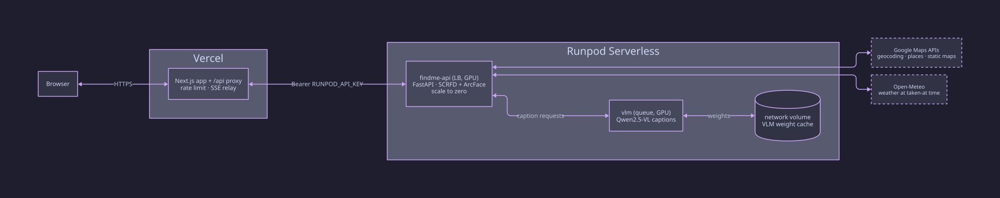

# findMe

**Using an agent?** Copy-paste the below text to your agent:

```
Deploy findMe by following every step in https://raw.githubusercontent.com/dwanderton/findme/main/AGENTS.md
```

Upload an album, enroll a selfie, get back every photo you appear in. Each
match carries where it was taken (Google Geocoding), the weather at capture
time (Open-Meteo), the camera settings that shot it (EXIF), and a generated
caption and tags (Qwen2.5-VL on Runpod).

Face detection (SCRFD) and embedding (ArcFace, 512-D) run on Runpod serverless
GPU workers, scale-to-zero. Matching uses a reference set per user with
bootstrap re-scoring: confident hits become extra references and everything
re-scores by mean of top-3 similarities.
Bands: strong at 0.45 cosine, possible at 0.37.

## Run locally (no cloud, no keys)

```bash
cd backend
uv venv --python 3.13 && uv pip install -e ".[dev]"
FINDME_STORAGE_ROOT=/tmp/findme FINDME_INLINE_JOBS=true DEBUG_UI=true \
  .venv/bin/python -m uvicorn --factory findme.app.factory:create_app --port 8000
```

```bash
cd frontend
npm install && npm run dev   # http://localhost:3000
```

The face engine runs on CPU locally (same models, same math as the GPU
workers). Without a Google key, place and weather show as absent.

## Tests

```bash
cd backend && .venv/bin/pytest            # unit, routes, golden pipeline, integration
cd frontend && npm test                   # logic, state machines, voice lint
cd frontend && npx playwright test        # live-stack core pathway
python scripts/smoke.py --expect-degraded # full workflow against a running backend
```

Golden accuracy tests run the real ONNX models on CPU: the two crowd-photo
assets share attendees that must cross-match at >= 0.90 cosine.

## Development

### API docs (Swagger UI)

The API is specified in [openapi.yaml](openapi.yaml) (OpenAPI 3.1). Browse it with Swagger UI:

```bash
python3 -m http.server 8777
# open http://localhost:8777/swagger.html
```

[swagger.html](swagger.html) loads Swagger UI 5 from CDN. Refresh the browser after
editing the spec.

After spec changes, regenerate the frontend types:

```bash
cd frontend && npm run gen-types
```

## Architecture



Regenerate: `d2 docs/architecture.d2 docs/architecture.svg`

## Deploy

See [DEPLOY.md](DEPLOY.md) (includes the live resource map and the Runpod-side
env table: VLM_BASE_URL, VLM_MODEL, RUNPOD_API_KEY on-worker, CORS_ORIGINS,
DEBUG_UI). Needs `RUNPOD_API_KEY` and `GOOGLE_MAPS_API_KEY`;
Vercel hosts the frontend. Standing cost when idle: the 20 GB volume
($1.40/mo); all compute is flex min=0.

### External API free tiers

| API | Free tier |
|-----|-----------|
| Google Geocoding | 10,000 requests/month |
| Google Maps Static | 10,000 requests/month |
| Google Places (New) | 10,000 requests/month |
| Open-Meteo | free for non-commercial use; fair-use guideline under 10,000 calls/day, no key required |

The enrichment cluster cache (place reused within a quarter mile, weather
within a mile and 30 minutes) keeps a typical album far below these limits.
